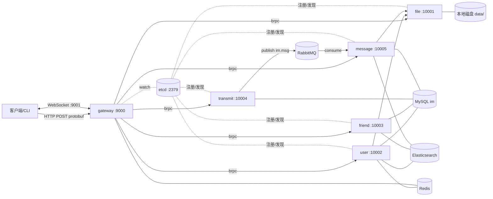

# IM 微服务渐进式开发计划

> 仓库：`~/ljt/IM`（Ubuntu 24.04）
> 参考项目：`D:\chat_pro\cpp-chatsystem-master`（只借鉴架构，代码自己写）
> 原则：**每个里程碑都能独立编译、运行、验证；做完一个再做下一个。**

## 0. 范围

**做：**

- 用户服务：注册、登录、登出、用户信息读写、头像
- 好友/会话服务：好友申请与处理、好友列表、会话列表、建群、成员列表
- 消息转发服务：组装消息、查会话成员、投递 MQ
- 消息存储服务：消费 MQ、MySQL 持久化、ES 检索、历史/最近/搜索
- 文件服务：上传/下载（磁盘存储，文件名用 uuid）
- 网关：HTTP 接口 + WebSocket 长连接、鉴权、消息推送
- 基础设施：etcd 注册发现、brpc 调用、Redis、RabbitMQ、MySQL(ODB)、Elasticsearch

**不做：**

- 语音识别（speech 服务、ASR SDK）
- 短信验证码（DMS SDK）
- 手机号注册/登录（不引入验证码；手机号最多作为可选资料字段，后续有需要再加）
- 客户端 GUI（先用 CLI 测试程序验证服务端；以后想接 Qt 再说）

## 1. 架构



分层：

| 层 | 内容 |
| --- | --- |
| 接入层 | gateway：HTTP 协议转换、WebSocket 鉴权与推送 |
| 业务层 | user / friend / transmit / message / file |
| 基础设施 | common：etcd、channel、redis、mysql、es、mq、logger、utils |
| 存储 | MySQL、Elasticsearch、Redis、RabbitMQ、本地磁盘 |
| 注册中心 | etcd |

## 2. 技术栈（本机已装，2026-10-27 校验）

| 组件 | 版本 | 用途 |
| --- | --- | --- |
| g++ | 13.3 | C++17 |
| CMake | 3.28 | 构建 |
| protobuf | 3.21.12 | 接口定义 + RPC 消息 |
| brpc | 1.18.0 | RPC 框架 |
| etcd / etcd-cpp-apiv3 | 3.5 / 0.15.4 | 注册中心 |
| ODB / libodb / libodb-mysql / libodb-boost | 2.6.0 | ORM |
| MySQL | 8.0.46 | 关系数据 |
| Redis / redis-plus-plus | 7.0.15 / 1.3.15 | 会话、在线状态 |
| RabbitMQ / AMQP-CPP | 3.12 / 4.3 | 异步消息 |
| Elasticsearch / elasticlient | 7.17.21 / 2.1.0 | 搜索 |
| spdlog / fmt / gflags / nlohmann-json | 1.12 / 9.1 / 2.2 / 3.11 | 日志、参数、JSON |
| websocketpp | 已装 | 网关长连接（M7 使用） |

## 3. 目录结构

```text
IM/
├── CMakeLists.txt
├── cmake/                 # CMake 辅助函数（protoc、odb 生成）
├── common/                # 基础设施封装（声明 .hpp / 实现 .cpp）
│   ├── logger.hpp / logger.cpp
│   ├── utils.hpp / utils.cpp
│   ├── etcd.hpp
│   ├── channel.hpp
│   ├── redis.hpp
│   ├── mysql.hpp
│   ├── es.hpp
│   ├── mq.hpp
│   └── db/                # 每张表的 DAO
├── proto/                 # 接口契约
├── odb/                   # ODB 实体（*.hxx）
├── services/
│   ├── echo/              # M0 示例：include/ 放声明，src/ 放实现
│   ├── user/              # 每个服务统一使用 include/ + src/
│   ├── friend/
│   ├── transmit/
│   ├── message/
│   ├── file/
│   └── gateway/
├── tests/                 # 各阶段验收用 CLI 客户端
├── sql/                   # 建库建表脚本
├── conf/                  # gflags 配置文件
├── docs/
├── data/                  # 文件服务存储、日志（gitignore）
└── third_party/           # 已有
```

## 4. 开发约定

1. **命名空间**统一 `im`；服务名：`user`、`friend`、`transmit`、`message`、`file`、`gateway`。
2. **proto 优先**：每个领域一个 `.proto`，`option cc_generic_services = true`；公共结构放 `base.proto`。
3. **错误处理**：RPC 响应统一 `request_id / success / errmsg`；每个方法开头写 `err_response` lambda。
4. **request_id**：客户端生成，全链路透传，日志必须带。
5. **配置**：gflags + `-flagfile`；IP、端口、密码全部走配置，代码里不写死。
6. **日志**：spdlog；调试模式控制台彩色，发布模式文件。
7. **数据库**：ODB 实体放 `odb/`，DAO 放 `common/db/`，每个 DAO 方法自己开事务。
8. **密码**：不存明文，存 `sha256(salt + password)` 与随机 salt（比参考项目更安全）。
9. **会话**：Redis 里 `session:<ssid> -> uid` 带 TTL；`online:<uid> -> ssid` 用于单点登录。
10. **提交**：每个里程碑一次 git commit，信息格式 `M0: ...`。
11. **测试**：`tests/` 下每个服务一个 CLI 客户端，能跑通验收命令。
12. **声明与实现分离**：每个服务统一 `include/`（.hpp）+ `src/`（.cpp）；公共模块 `common/` 同样只放声明与实现分离后的文件。

## 5. 里程碑

### M0 工程骨架与 RPC 闭环

**目标**：把构建系统、日志、proto 生成、brpc 调用跑通。

**交付**：

- 根 `CMakeLists.txt` + `cmake/Proto.cmake`
- `common/logger.hpp`、`common/utils.hpp`
- `proto/echo.proto`、`services/echo/echo_server.cpp`、`tests/echo_client.cpp`
- `conf/echo.conf`

**验收**：

```bash
cmake -S . -B build -DCMAKE_BUILD_TYPE=Debug
cmake --build build -j4
./build/bin/echo_server -flagfile=conf/echo.conf &
./build/bin/echo_client -host=127.0.0.1:10000 -msg=hello
# 输出 echo: hello，退出码 0
```

**学到**：brpc 服务端/客户端最小闭环、gflags、spdlog、CMake target、protoc 集成。

---

### M1 注册发现 + 文件服务

**目标**：第一个真正“可被发现”的微服务。

**交付**：

- `common/etcd.hpp`：`Registry`（租约 3s + 自动续租）、`Discovery`（先全量 `ls`，再 `watch`）
- `common/channel.hpp`：`ServiceChannel`（一组 brpc channel，轮询选节点）、`ServiceManager`（按服务名管理）
- `proto/file.proto`：`PutFile` / `GetFile` / `GetMultiFile`
- `services/file/`：磁盘存储，文件名用 uuid
- `tests/file_client.cpp`

**要点**：

- 注册 key：`/im/service/<service>/<instance>`，value 为 `host:port`
- 文件名校验：只允许 uuid 格式，拒绝 `..`、`/`，防止路径穿越（参考项目没做）
- 单文件大小上限（先 64MB）

**验收**：

```bash
etcdctl get --prefix /im/service/file
./build/bin/file_server -flagfile=conf/file.conf &
./build/bin/file_client -op=put -file=./docs/开发计划.md
./build/bin/file_client -op=get -file_id=<上一步返回的 id> -out=/tmp/out.md
diff ./docs/开发计划.md /tmp/out.md   # 内容一致
```

**学到**：服务注册/发现、客户端负载均衡、文件服务设计。

---

### M2 数据层：ODB + MySQL

**目标**：把 user 表跑通，形成“实体 → DAO → 测试程序”的模板。

**交付**：

- `odb/user.hxx` + `sql/user.sql`
- `common/mysql.hpp`：ODB 连接池工厂
- `common/db/user_dao.hpp`：插入、按 user_id/nickname 查询、更新
- `tests/db_user_test.cpp`

**验收**：

```bash
mysql -uroot -p*** < sql/user.sql
./build/bin/db_user_test
# 插入 → 查询 → 更新 → 重复昵称插入失败
```

**前置**：需要 MySQL root 密码（见第 9 节）。

---

### M3 用户服务

**目标**：注册/登录/鉴权闭环。

**交付**：

- `proto/user.proto`：`Register`、`Login`、`Logout`、`GetUserInfo`、`GetMultiUserInfo`、`SetNickname`、`SetDescription`、`SetAvatar`
- `common/redis.hpp`：`SessionStore`、`OnlineStore`
- `services/user/`：业务实现 + 注册到 etcd
- `tests/user_client.cpp`

**要点**：

- 注册：校验昵称/密码格式 → 查重 → 写 MySQL → 写 ES（可选，失败只告警不回滚）
- 登录：校验密码哈希 → 检查是否已在线 → 生成 ssid → 写 Redis（TTL 7 天）→ 返回 ssid
- 登出：删 ssid、删 online
- 头像：先调 file 服务上传拿 `file_id`，再写库；查信息时按需拉取头像字节

**验收**：

```bash
./build/bin/user_server -flagfile=conf/user.conf &
./build/bin/user_client -op=register -nickname=alice -password=123456
./build/bin/user_client -op=login -nickname=alice -password=123456
./build/bin/user_client -op=get -ssid=<ssid>
./build/bin/user_client -op=set_nickname -ssid=<ssid> -value=alice2
```

---

### M4 好友与会话服务

**目标**：关系模型 + 会话模型。

**交付**：

- `odb/relation.hxx`、`odb/friend_apply.hxx`、`odb/chat_session.hxx`、`odb/chat_session_member.hxx`
- 对应 SQL 与 DAO
- `proto/friend.proto`：`GetFriendList`、`FriendAdd`、`FriendAddProcess`、`FriendRemove`、`FriendSearch`、`GetPendingEvents`、`GetChatSessionList`、`CreateChatSession`、`GetChatSessionMembers`
- `services/friend/` + `tests/friend_client.cpp`

**要点**：

- 好友关系双向存两条；申请记录处理后删除
- 同意好友：关系 + 单聊会话 + 两条成员，尽量放在一个事务里
- 会话列表：单聊补对方昵称/头像；最后一条消息调 message 服务
- 群聊创建：会话 + 成员列表

**验收**：

```bash
./build/bin/friend_client -op=add -from=alice -to=bob
./build/bin/friend_client -op=pending -user=bob
./build/bin/friend_client -op=process -event=<id> -agree=true
./build/bin/friend_client -op=sessions -user=alice   # 出现单聊会话
```

---

### M5 消息转发服务

**目标**：消息组装 + MQ 生产。

**交付**：

- `proto/transmit.proto`：`SendMessage`
- `common/mq.hpp`：AMQP-CPP 封装（声明交换机/队列、publish、consume）
- `services/transmit/` + `tests/transmit_client.cpp`

**要点**：

- 发送者信息从 user 服务取
- **校验发送者是否属于该会话**（参考项目没校验，这里补上）
- 消息 ID 用 uuid，时间戳服务端生成
- MQ：exchange `im.msg`（direct）、queue `im.msg.persist`、routing key `im.msg.persist`，durable
- 返回完整 `MessageInfo` + 目标用户列表

**验收**：

```bash
./build/bin/transmit_client -op=send -ssid=<ssid> -session=<sid> -text=hello
rabbitmqctl list_queues name messages   # im.msg.persist 有 1 条
./build/bin/transmit_client -op=send -ssid=<非成员 ssid> -session=<sid> -text=x  # 被拒绝
```

---

### M6 消息存储服务

**目标**：异步持久化 + 历史/搜索。

**交付**：

- `odb/message.hxx` + SQL + DAO
- `proto/message.proto`：`GetHistory`、`GetRecent`、`Search`
- `services/message/`：MQ 消费 + MySQL + ES
- `tests/message_client.cpp`

**要点**：

- 文本消息写 ES；图片/文件/语音先传 file 服务拿 `file_id`，再落 MySQL
- **手动 ack**：成功才 ack，失败 nack/重试（参考项目无条件 ack，会丢消息）
- ES 索引 `im_message`：`session_id`(keyword)、`sender_id`(keyword)、`content`(text)、`created_at`(long)
- 历史查询分页（`limit`/`offset` 或游标），避免一次拉全部文件内容

**验收**：

```bash
./build/bin/message_client -op=history -session=<sid>
./build/bin/message_client -op=search -session=<sid> -key=hello
# MySQL message 表有记录，ES 能搜到
```

---

### M7 网关

**目标**：HTTP + WebSocket 统一入口。

**交付**：

- `proto/notify.proto`：`Notify`（好友申请、处理结果、新会话、新消息、被删好友）
- `services/gateway/`：httplib HTTP + websocketpp 长连接
- `tests/ws_client.cpp`：两个客户端互发消息

**要点**：

- HTTP：统一 `POST /api/...`，body 是 protobuf；先查 Redis 拿 uid，再填 `user_id` 转发 brpc
- WebSocket：第一帧 `AuthReq{session_id}` 鉴权，绑定 `uid -> connection`；60s 心跳；断开清理
- 推送：网关把 `Notify` 序列化后发给在线用户
- **线程安全**：ws 的 `send` 统一 `asio::post` 到 io_context，不跨线程直接调（参考项目的隐患）
- 路由表集中在 `gateway/routes.hpp`，一个请求一个 handler

**验收**：

```bash
./build/bin/gateway_server -flagfile=conf/gateway.conf &
./build/bin/ws_client -user=alice ...   # 终端 A
./build/bin/ws_client -user=bob ...     # 终端 B
# A 发消息，B 立即收到；关闭 A 后 Redis 会话被清理
```

---

### M8 端到端联调与部署

**目标**：一键起全套，完整走一遍业务。

**交付**：

- `docker-compose.yml`（etcd/mysql/redis/es/rabbitmq）
- 各服务 dockerfile + `entrypoint.sh` 等端口
- `scripts/e2e.sh`：注册 → 登录 → 加好友 → 建会话 → 发消息 → 拉历史 → 搜索
- `README.md` 运行说明

**验收**：

```bash
docker compose up -d
./scripts/e2e.sh
# 全部步骤 PASS
```

---

### M9（可选）加固

- 限流、超时、重试、熔断
- 消息可靠投递（重试队列 + 死信）
- 权限校验全覆盖（会话成员、文件归属）
- 监控指标（QPS、延迟、错误率）
- 客户端 GUI

## 6. 数据模型

```text
user                (id, user_id, nickname, password_hash, salt, description,
                     avatar_id, created_at)
relation            (id, user_id, peer_id, created_at)          unique(user_id, peer_id)
friend_apply        (id, event_id, from_user, to_user, created_at)
chat_session        (id, session_id, name, type, created_at)    type: 0 单聊 1 群聊
chat_session_member (id, session_id, user_id, joined_at)        unique(session_id, user_id)
message             (id, message_id, session_id, sender_id, type, content,
                     file_id, file_name, file_size, created_at)
```

索引：

- `user.user_id` unique、`user.nickname` unique
- `message(session_id, created_at)` 普通索引（历史分页）
- `chat_session_member(user_id)`、`chat_session_member(session_id)`
- `relation(peer_id)`

## 7. 接口清单

| proto | 服务 | 方法 |
| --- | --- | --- |
| base.proto | - | UserInfo、ChatSessionInfo、MessageInfo、MessageContent |
| file.proto | FileService | PutFile、GetFile、GetMultiFile |
| user.proto | UserService | Register、Login、Logout、GetUserInfo、GetMultiUserInfo、SetNickname、SetDescription、SetAvatar |
| friend.proto | FriendService | GetFriendList、FriendAdd、FriendAddProcess、FriendRemove、FriendSearch、GetPendingEvents、GetChatSessionList、CreateChatSession、GetChatSessionMembers |
| transmit.proto | TransmitService | SendMessage |
| message.proto | MessageService | GetHistory、GetRecent、Search |
| notify.proto | - | Notify（WebSocket 推送结构） |

网关 HTTP 路径（M7 定稿）：

```text
POST /api/user/register
POST /api/user/login
POST /api/user/logout
POST /api/user/info
POST /api/user/set_nickname
POST /api/user/set_description
POST /api/user/set_avatar
POST /api/friend/list
POST /api/friend/add
POST /api/friend/process
POST /api/friend/remove
POST /api/friend/search
POST /api/friend/pending
POST /api/session/list
POST /api/session/create
POST /api/session/members
POST /api/message/send
POST /api/message/history
POST /api/message/recent
POST /api/message/search
POST /api/file/put
POST /api/file/get
WS   /ws
```

## 8. 端口

| 服务 | 端口 |
| --- | --- |
| echo（仅 M0） | 10000 |
| file | 10001 |
| user | 10002 |
| friend | 10003 |
| transmit | 10004 |
| message | 10005 |
| gateway HTTP / WS | 9000 / 9001 |
| etcd | 2379 |
| MySQL | 3306 |
| Redis | 6379 |
| RabbitMQ | 5672 |
| Elasticsearch | 9200 |

## 9. 运行方式

本地（不使用 Docker）：

```bash
# 中间件按需启动
sudo systemctl start etcd mysql redis-server rabbitmq-server elasticsearch

# 构建
cmake -S . -B build -DCMAKE_BUILD_TYPE=Debug
cmake --build build -j4

# 单服务
./build/bin/user_server -flagfile=conf/user.conf
```

**前置条件**：MySQL root 密码目前未知（空密码、123456、root 都试过不行），M2 之前需要确认；或者用 Docker 起一个 MySQL（密码 123456）。

## 10. 风险与前置条件

| 项 | 说明 |
| --- | --- |
| MySQL 密码 | M2 的硬前置，需要你提供或重置 |
| 内存 7.7G | 编译 brpc 链接较重，`-j` 不要超过 4 |
| ES 单节点 | 9200 已占用，索引名加 `im_` 前缀避免冲突 |
| 端口占用 | 10000–10005、9000/9001 目前空闲 |
| websocketpp | 已安装；如编译问题备选 boost::beast |
| gflags 配置文件 | `-flagfile` 每行一个 `-name=value`，支持 `#` 注释 |

## 11. 进度记录

| 里程碑 | 状态 | 完成时间 | 备注 |
| --- | --- | --- | --- |
| M0 工程骨架 | ✅ 完成 | 2026-10-27 | echo 闭环已验证 |
| M1 注册发现 + 文件 | ⬜ 未开始 | | |
| M2 数据层 | ⬜ 未开始 | | 等 MySQL 密码 |
| M3 用户服务 | ⬜ 未开始 | | |
| M4 好友会话 | ⬜ 未开始 | | |
| M5 消息转发 | ⬜ 未开始 | | |
| M6 消息存储 | ⬜ 未开始 | | |
| M7 网关 | ⬜ 未开始 | | |
| M8 联调部署 | ⬜ 未开始 | | |
