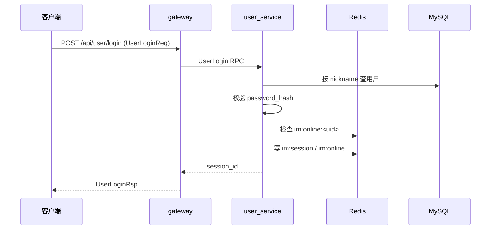

# 接口设计（M3 用户服务）

> 状态：已确认（采用 account 登录）
> 关联：`docs/开发计划.md`、`AGENTS.md`
> 范围：**只覆盖 M3 用户服务**；后续每进入一个里程碑，在本文追加对应章节，不提前设计未实现模块。

## 1. 范围

M3 提供：

- 用户名 + 密码注册
- 用户名 + 密码登录 / 登出
- 获取单个用户信息、批量获取用户信息（内部接口）
- 修改昵称、个人签名、头像

不做（与开发计划一致）：

- 手机号注册/登录、短信验证码
- 第三方登录、找回密码
- 好友关系、消息（后续里程碑）

## 2. 通用约定

### 2.1 协议与文件

- 传输协议：brpc（baidu_std），消息体为 protobuf3。
- 命名空间：`package im;`，`option cc_generic_services = true;`。
- 公共结构放 `base.proto`，每个领域一个 proto 文件（M3 为 `user.proto`）。
- 网关对外：HTTP POST，`Content-Type: application/x-protobuf`，正文就是对应 Req 的序列化结果，响应正文是对应 Rsp。

### 2.2 请求 / 响应结构

- 每个请求第一个字段固定为 `string request_id = 1;`，由客户端生成（UUID），全链路透传，用于日志串联。
- 每个响应固定包含：
  - `string request_id = 1;`
  - `bool success = 2;`
  - `string errmsg = 3;`（成功时为空）
- 失败时只填 `errmsg`，不返回半成品数据。

### 2.3 身份与鉴权

- `session_id` 是登录凭证，只在客户端 → 网关之间传递。
- 网关根据 `session_id` 从 Redis 解析出 `user_id` 并填入请求；**子服务不信任客户端传的 `user_id`**。
- 子服务的公开接口（需要登录的）要求 `user_id` 非空；为空视为未认证。
- 内部接口（如 `GetMultiUserInfo`）由其他服务调用，不经过网关，不需要 `session_id`。

### 2.4 字段与命名

- 字段名 `snake_case`，消息名 `PascalCase`，RPC 方法用动词开头（`UserRegister`、`GetUserInfo`）。
- 可空字段用 `optional`；proto3 optional 需要 `--experimental_allow_proto3_optional`（已在构建里配置）。
- 时间统一用 `int64` 秒级时间戳；如果后续需要毫秒再新增字段，不改原字段语义。
- 字段编号一旦发布不复用、不改类型；新增字段用新编号。

### 2.5 错误处理

- 本期错误用 `success + errmsg` 表达，`errmsg` 是可直接展示给用户的简短中文。
- 不区分错误码（后续 M9 再统一加 `code` 字段，避免现在过度设计）。
- 服务端日志记录 `request_id`、`user_id`、失败原因；日志里不打印密码、session_id。

### 2.6 限制

| 项 | 规则 |
| --- | --- |
| account | 4–20 字符，字母开头，仅字母、数字、`_`，全局唯一、不可修改 |
| 昵称 | 3–16 字符，仅字母、数字、`_`、`-`，仅展示，不要求唯一 |
| 密码 | 6–32 字符，可见 ASCII，不含空格 |
| 个人签名 | 0–128 字符（UTF-8） |
| 头像 | ≤ 2MB，仅登录后可改 |
| request_id | 36 字符 UUID |
| 会话有效期 | 7 天（Redis TTL） |

密码存储：`sha256(salt + password)`，每个用户独立随机 salt（16 字节 hex）。
说明：这是教学项目的折中方案，生产环境应使用 bcrypt/argon2。

### 2.7 用户标识符

| 标识 | 作用 | 是否可变 |
| --- | --- | --- |
| `account` | 登录名，全局唯一 | 不可变 |
| `user_id` | 内部业务主键（uuid），好友关系、会话成员、消息发送者都存它 | 不可变 |
| `nickname` | 展示名 | 可改，不要求唯一 |

登录使用 `account + password`；`nickname` 只负责展示和搜索。

后续“加好友”使用的标识（M4 再细化接口）：

1. 客户端先调“搜索用户”（M4 支持按 account / 昵称搜索），拿到 `UserInfo.user_id`；
2. 再调 `FriendAdd`，传 `respondent_id = 对方 user_id`；
3. 好友关系表、会话成员表、消息表只存 `user_id`。

## 3. 数据结构（base.proto）

```proto
syntax = "proto3";
package im;

option cc_generic_services = true;

// 用户公开信息：其他服务返回用户时统一使用该结构
message UserInfo {
    string user_id     = 1;
    string nickname    = 2;
    string description = 3;   // 个人签名，可为空
    bytes  avatar      = 4;   // 头像文件内容；列表接口可为空，按需拉取
}
```

## 4. 用户服务接口（user.proto）

### 4.1 proto 定义

```proto
syntax = "proto3";
package im;
import "base.proto";

option cc_generic_services = true;

// 用户名注册
message UserRegisterReq {
    string request_id = 1;
    string account    = 2;   // 登录名，注册后不可修改
    string nickname   = 3;   // 展示名
    string password   = 4;
}
message UserRegisterRsp {
    string request_id = 1;
    bool   success    = 2;
    string errmsg     = 3;
    string user_id    = 4;   // 注册成功后返回
}

// 用户名登录
message UserLoginReq {
    string request_id = 1;
    string account    = 2;
    string password   = 3;
}
message UserLoginRsp {
    string request_id = 1;
    bool   success    = 2;
    string errmsg     = 3;
    string session_id = 4;   // 登录成功后返回
}

// 登出
message UserLogoutReq {
    string request_id = 1;
    optional string session_id = 2;
    optional string user_id    = 3;   // 网关注入
}
message UserLogoutRsp {
    string request_id = 1;
    bool   success    = 2;
    string errmsg     = 3;
}

// 获取当前登录用户信息
message GetUserInfoReq {
    string request_id = 1;
    optional string session_id = 2;
    optional string user_id    = 3;   // 网关注入
}
message GetUserInfoRsp {
    string request_id = 1;
    bool   success    = 2;
    string errmsg     = 3;
    UserInfo user_info = 4;
}

// 批量获取用户信息（内部接口，不经过网关）
message GetMultiUserInfoReq {
    string request_id = 1;
    repeated string user_ids = 2;
}
message GetMultiUserInfoRsp {
    string request_id = 1;
    bool   success    = 2;
    string errmsg     = 3;
    map<string, UserInfo> users = 4;  // user_id -> 用户信息
}

// 修改昵称
message SetUserNicknameReq {
    string request_id = 1;
    optional string session_id = 2;
    optional string user_id    = 3;
    string nickname = 4;
}
message SetUserNicknameRsp {
    string request_id = 1;
    bool   success    = 2;
    string errmsg     = 3;
}

// 修改个人签名
message SetUserDescriptionReq {
    string request_id = 1;
    optional string session_id = 2;
    optional string user_id    = 3;
    string description = 4;
}
message SetUserDescriptionRsp {
    string request_id = 1;
    bool   success    = 2;
    string errmsg     = 3;
}

// 修改头像
message SetUserAvatarReq {
    string request_id = 1;
    optional string session_id = 2;
    optional string user_id    = 3;
    bytes  avatar = 4;
}
message SetUserAvatarRsp {
    string request_id = 1;
    bool   success    = 2;
    string errmsg     = 3;
}

service UserService {
    rpc UserRegister(UserRegisterReq) returns (UserRegisterRsp);
    rpc UserLogin(UserLoginReq) returns (UserLoginRsp);
    rpc UserLogout(UserLogoutReq) returns (UserLogoutRsp);
    rpc GetUserInfo(GetUserInfoReq) returns (GetUserInfoRsp);
    rpc GetMultiUserInfo(GetMultiUserInfoReq) returns (GetMultiUserInfoRsp);
    rpc SetUserNickname(SetUserNicknameReq) returns (SetUserNicknameRsp);
    rpc SetUserDescription(SetUserDescriptionReq) returns (SetUserDescriptionRsp);
    rpc SetUserAvatar(SetUserAvatarReq) returns (SetUserAvatarRsp);
}
```

### 4.2 接口说明

| 接口 | 鉴权 | 关键行为 | 主要失败 |
| --- | --- | --- | --- |
| `UserRegister` | 否 | 校验 account/昵称/密码 → 查 account 重 → 写 MySQL → 返回 `user_id` | account 格式错误、account 已存在、昵称格式错误、数据库错误 |
| `UserLogin` | 否 | 查 account → 校验密码哈希 → 检查是否已在线 → 生成 session | 用户不存在、密码错误、已在其他设备登录 |
| `UserLogout` | 是 | 删除会话和在线标记 | 会话不存在 |
| `GetUserInfo` | 是 | 查 MySQL，按需拉头像 | 用户不存在 |
| `GetMultiUserInfo` | 内部 | 批量查 MySQL | 空列表直接返回空 |
| `SetUserNickname` | 是 | 校验格式 → 查重 → 更新 | 昵称被占用 |
| `SetUserDescription` | 是 | 校验长度 → 更新 | 超长 |
| `SetUserAvatar` | 是 | 上传到 file 服务拿 file_id → 更新 | 头像过大、文件服务失败 |

### 4.3 校验规则

- account：`^[A-Za-z][A-Za-z0-9_]{3,19}$`（4–20 位，字母开头）。
- 昵称：`^[A-Za-z0-9_-]{3,16}$`，仅展示，不校验唯一。
- 密码：长度 6–32，字符范围 `0x21–0x7E`（可见 ASCII，不含空格）。
- 签名：长度 ≤ 128。
- 头像：≤ 2MB；先调 file 服务的 `PutFile`，拿到的 `file_id` 存进 `user.avatar_id`。
- 注册成功后 account 全局唯一（数据库唯一索引兜底）。
- `GetMultiUserInfo`：单次最多 100 个 `user_id`，超过直接返回失败。

### 4.4 错误场景

| 场景 | errmsg |
| --- | --- |
| account 格式非法 | `account 格式不合法` |
| account 已存在 | `account 已被占用` |
| 昵称格式非法 | `昵称格式不合法` |
| 密码格式非法 | `密码格式不合法` |
| 用户不存在 / 密码错误 | `用户名或密码错误` |
| 已在线 | `用户已在其他设备登录` |
| 未认证 | `未登录或会话已过期` |
| 签名过长 | `签名长度超过限制` |
| 头像过大 | `头像大小超过限制` |
| 批量查询超限 | `一次最多查询 100 个用户` |

## 5. 会话与 Redis

| Key | Value | TTL | 用途 |
| --- | --- | --- | --- |
| `im:session:<session_id>` | `user_id` | 7 天 | 会话 → 用户 |
| `im:online:<user_id>` | `session_id` | 7 天 | 在线标记 / 单点登录 |

规则：

- 登录：若 `im:online:<uid>` 已存在 → 拒绝（单点登录）。
- 登录成功：写两个 key，TTL 7 天。
- 登出：删除两个 key。
- 会话过期：网关查不到 session，返回“未登录或会话已过期”。
- 网关在 M7 实现 `session_id → user_id` 的解析；M3 只负责写入/删除。

## 6. 网关 HTTP 映射（M7 实现，契约先定）

| 方法 | 路径 | 请求体 | 响应体 |
| --- | --- | --- | --- |
| POST | `/api/user/register` | `UserRegisterReq` | `UserRegisterRsp` |
| POST | `/api/user/login` | `UserLoginReq` | `UserLoginRsp` |
| POST | `/api/user/logout` | `UserLogoutReq` | `UserLogoutRsp` |
| POST | `/api/user/info` | `GetUserInfoReq` | `GetUserInfoRsp` |
| POST | `/api/user/set_nickname` | `SetUserNicknameReq` | `SetUserNicknameRsp` |
| POST | `/api/user/set_description` | `SetUserDescriptionReq` | `SetUserDescriptionRsp` |
| POST | `/api/user/set_avatar` | `SetUserAvatarReq` | `SetUserAvatarRsp` |

约定：

- 除注册/登录外，请求必须带 `session_id`。
- 网关解析 `session_id` 后覆盖 `user_id`，客户端传的 `user_id` 无效。
- 未认证统一返回 `success=false, errmsg=未登录或会话已过期`。
- `GetMultiUserInfo` 不暴露 HTTP。

## 7. 典型流程

登录：



修改昵称：

```text
客户端 POST /api/user/set_nickname(session_id, nickname)
  -> 网关 session_id -> user_id
  -> user_service: 格式校验 -> 查重 -> 更新 MySQL -> 尝试更新 ES
  -> 返回 success/errmsg
```

## 8. 兼容与演进

- 新增字段一律加新编号并使用 `optional`，不改旧字段语义。
- 删除接口先标注 deprecated，保留至少一个里程碑。
- 网关与子服务之间的 `user_id` 注入规则不变；后续 WebSocket 推送复用 `session_id` 体系。

## 9. 设计确认记录

已确认：

1. 单点登录：第二处登录**拒绝**。
2. 会话 TTL：7 天。
3. 昵称规则：3–16 字符，字母/数字/`_`/`-`，仅展示。
4. 头像上限：2MB。
5. `GetMultiUserInfo`：单次最多 100 个 id。
6. 注册：返回 `user_id`。
7. 采用方案 B：新增不可变 `account` 作为登录名，昵称只做展示。
   - account：4–20 位，字母开头，仅字母/数字/`_`，全局唯一。
   - 登录：`account + password`。
   - 昵称可改、不要求唯一；好友搜索按 account/昵称，关系存 `user_id`。

## 10. M4 好友与会话接口

接口以 `proto/friend.proto` 为准，这里记录语义约定。

| 接口 | 鉴权 | 关键行为 |
| --- | --- | --- |
| `GetFriendList` | 是 | 查关系表，批量补用户信息 |
| `FriendAdd` | 是 | 不能加自己；已是好友/已申请则拒绝；写申请并返回 event_id |
| `FriendAddProcess` | 是 | 同意：事务内删申请、写双向关系、建单聊、写两个成员；拒绝：只删申请 |
| `GetPendingFriendEventList` | 是 | 查自己收到的申请，补申请人信息 |
| `FriendRemove` | 是 | 删除双向关系（会话保留） |
| `FriendSearch` | 是 | ES `im_user` 按 account/nickname 模糊匹配，排除自己，最多 20 条 |
| `GetChatSessionList` | 是 | 查自己加入的会话；单聊补对方昵称/信息，群聊返回群名 |
| `ChatSessionCreate` | 是 | 建群，成员列表必须包含创建者 |
| `GetChatSessionMember` | 是 | 按会话查成员并补用户信息 |

约定：

- 好友关系、会话成员、消息都只存 `user_id`；`nickname`/`account` 只用于展示和搜索。
- 单聊会话 `type=0`，群聊 `type=1`；单聊的 `name` 由对方昵称填充。
- 会话列表暂不返回“最后一条消息”（依赖 M6 消息服务，后续补）。
- 同意好友使用单事务，保证申请删除、关系、会话、成员同时生效。

## 11. M5 消息转发接口

`proto/transmit.proto`：

```text
SendMessageReq { request_id, session_id, user_id, chat_session_id, MessageContent }
SendMessageRsp { request_id, success, errmsg, MessageInfo, repeated target_ids }
```

语义：

- 发送者必须属于该会话，否则返回“无权在该会话发送消息”。
- 服务端生成 `message_id`（uuid）和 `timestamp`（秒），从 user 服务补全发送者信息。
- 投递到 RabbitMQ：exchange `im.msg`、queue `im.msg.persist`（durable）、routing key `im.msg.persist`。
- 响应里的 `target_ids` 是该会话全部成员，由网关（M7）决定推送给谁。

## 12. M6 消息存储与查询

消费：message 服务订阅 `im.msg.persist`，把 `MessageInfo` 落 MySQL `message` 表，并写 ES `im_message` 索引。

查询接口（`proto/message.proto`）：

| 接口 | 参数 | 行为 |
| --- | --- | --- |
| `GetHistory` | `chat_session_id, start_time, end_time` | MySQL 按会话+时间范围查，补发送者信息；`start_time=0` 从 2000-01-01 开始 |
| `GetRecent` | `chat_session_id, count` | 查会话消息后按时间倒序取 N 条 |
| `Search` | `chat_session_id, search_key` | ES 按会话+content 通配符搜索，回 MySQL 取详情 |

存储字段：

- `message(message_id, session_id, sender_id, type, content, file_id, file_name, file_size, created_at)`
- 文本消息存 `content`；图片/文件/语音存 `file_id` 等元信息，ES 里 content 为空。

## 缓存一致性

transmit 服务对以下数据做本地缓存：

| 缓存 | TTL | 失效方式 |
| --- | --- | --- |
| 会话成员列表 | 30 秒 | 到期自动失效 |
| 发送者 UserInfo | 60 秒 | 到期自动失效 |

当前采用**最终一致**：

- 新成员加入会话后，最多 30 秒内可能收不到该会话消息；
- 用户修改昵称/头像后，消息里展示的发送者信息最多 60 秒后更新。

暂未实现主动失效（需要 friend 服务在成员变更时通知 transmit，会增加服务间耦合），如后续要求强一致，可增加 Redis pub/sub 或 MQ 失效事件。
